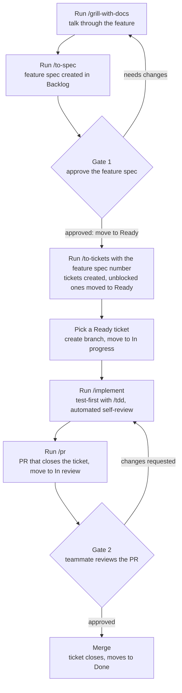
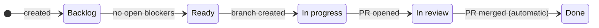
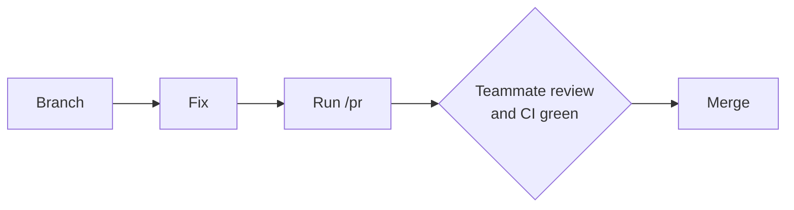

# How we work

Every feature goes from an idea to `main` through the same loop. Agent skills do the heavy lifting; people make the two decisions that matter: is the plan right, and is the code right.

Terms used here (feature spec, ticket, module spec) are defined in [GLOSSARY.md](../GLOSSARY.md).

## The feature loop

| Step            | Run                                                                        | Result                                                                                                                                                                                                                                |
| --------------- | -------------------------------------------------------------------------- | ------------------------------------------------------------------------------------------------------------------------------------------------------------------------------------------------------------------------------------- |
| 1. Plan         | `/grill-with-docs`                                                         | The agent interviews you until the feature is clear. New terms go into `GLOSSARY.md`, hard-to-reverse decisions into `docs/adr/`.                                                                                                     |
| 2. Feature spec | `/to-spec`                                                                 | A feature spec (GitHub issue) appears on the Nimbus Board in **Backlog**. It gets the `ready-for-agent` label straight away; that only means it is written for an agent to build, not that it is approved.                            |
| 3. **Gate 1**   | Read it                                                                    | You approve your own feature spec and move it to **Ready**. Ask a teammate to approve it instead when it touches another member's module, permissions, or a shared API contract. The **Ready** column is the approval, not the label. |
| 4. Tickets      | `/to-tickets #<feature-spec>`                                              | Pass the feature spec number so the tickets become its sub-issues, with "blocked by" links. Then move the feature spec to **In progress**, and move tickets with no blockers to **Ready**.                                            |
| 5. Start        | `git switch main`, `git pull`, then `git switch -c <ticket#>-<short-name>` | Branch created **before** `/implement`, because it commits to the current branch. Move the ticket to **In progress**.                                                                                                                 |
| 6. Build        | `/implement`                                                               | Test-first code (`/tdd`) plus an automated review of its own work. If the change touches a module's public API, events, tables or REST endpoints, update its module spec in `docs/specs/` in the same branch.                         |
| 7. PR           | `/pr`                                                                      | Check the PR description has `Closes #<ticket>` (the ticket number is the start of the branch name); add it if missing. Move the ticket to **In review**. CI runs on the PR.                                                          |
| 8. **Gate 2**   | Teammate review                                                            | A teammate reviews the PR. CI must be green.                                                                                                                                                                                          |
| 9. Merge        | Merge on GitHub                                                            | The ticket closes and moves to **Done** automatically. Whoever merged moves any tickets this one was blocking, and that have no other open blockers, to **Ready**.                                                                    |

## Board columns

- **Tickets** move through every column. Everything except **Done** is moved by hand:
  - to **Ready** by whoever runs `/to-tickets` (tickets with no blockers) or merges a blocking ticket (tickets it unblocked)
  - to **In progress** when you create the branch, to **In review** when you open the PR
  - to **Done** automatically when the PR merges
- A **feature spec** goes Backlog → **Ready** at gate 1 → **In progress** once its tickets exist. Close it when all its tickets are done; it then moves to **Done**. So **Ready** only ever holds tickets you can pick up.
- New feature specs and tickets land in **Backlog** through the board's _Auto-add to project_ workflow (filter: this repo, `is:issue is:open`). The skills themselves don't touch the board, so keep that workflow on.

## Rules

- **Branches:** from an up-to-date `main`, named `<ticket#>-<short-name>` (e.g. `42-roles-page`).
- **PRs:** always include `Closes #<ticket>`, so merging closes the ticket.
- **Module specs:** updated in the same PR as the code they describe.
- **CI** must pass before merging.

## Fast path for small changes

Typos, small bug fixes and config tweaks skip planning:

If the fix has a ticket, still name the branch after it and add `Closes #<ticket>`. If it grows beyond a quick fix, switch to the full loop.
