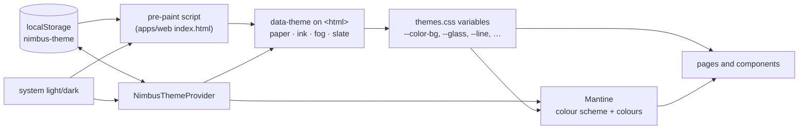

# @repo/ui

Shared React UI for Nimbus: the theme system and the components every page builds on. Used by `apps/web`, and later by `apps/desktop`. Design source: the "Nimbus Themes" project in claude.ai/design (feature spec #66).

## The four themes

Two settings pick the theme:

|           | flat                | glass |
| --------- | ------------------- | ----- |
| **light** | Paper (the default) | Fog   |
| **dark**  | Ink (the default)   | Slate |

Until a User chooses light or dark, the mode follows their system's setting, live. **System** in the Appearance picker goes back to that. The surface starts flat. Both choices are kept in the browser (`localStorage`, key `nimbus-theme`) and shared by every open tab.

## How it works



- **`NimbusThemeProvider`** is the one place that decides the theme. It wraps `MantineProvider`, sets `data-theme` on `<html>`, makes Mantine's light/dark follow the mode, saves choices and follows changes made in other tabs. It also draws the background glow, which shows on Fog and Slate only.
- **`themes.css`** holds the four themes as CSS variables (names and values from the design), the 2px orange focus ring, Poppins (bundled from `@fontsource/poppins`, no font CDN) and the shared components' styles.
- **`theme.ts`** is the Mantine theme: the orange palette built around `#ff6b3d`, Poppins, `xl` corners, pill buttons and inputs, and dark text on filled orange. Its `cssVariablesResolver` points Mantine's own colours (body, text, dimmed, borders, the orange shades) at the theme variables, so stock Mantine components match all four themes without any styling.
- **The pre-paint script** in `apps/web/index.html` applies the saved theme before React loads, so a reload doesn't flash the wrong theme. It must read the same key and pick the theme the same way as the provider.

## Using it in a page

Pages already sit inside `NimbusThemeProvider` (in the app's entry point), so plain Mantine components are themed. Reach for these when the design calls for them:

| Import                                           | What it is                                                                                                                                                                                                                    |
| ------------------------------------------------ | ----------------------------------------------------------------------------------------------------------------------------------------------------------------------------------------------------------------------------- |
| `Panel` from `@repo/ui/panel`                    | A rounded surface for grouping content; glass on Fog and Slate, solid with a hairline on Paper and Ink.                                                                                                                       |
| `PillTabs` from `@repo/ui/pill-tabs`             | Pill-shaped tabs (a Mantine `SegmentedControl`), as on the Roles pages.                                                                                                                                                       |
| `ScopePill` from `@repo/ui/scope-pill`           | A small segmented choice on a soft track, such as Own / Project / All.                                                                                                                                                        |
| `RoundCheck` from `@repo/ui/round-check`         | A round orange check (a Mantine `Checkbox`).                                                                                                                                                                                  |
| `ThemePicker` from `@repo/ui/theme-picker`       | System and the four themes, as on Settings → Appearance.                                                                                                                                                                      |
| `ThemeToggles` from `@repo/ui/theme-toggles`     | The navbar's theme capsule: a sun/moon button for light and dark, and a glass button that is orange while on.                                                                                                                 |
| `ArrowButton` from `@repo/ui/arrow-button`       | A page's or window's main action: an orange pill with a round arrow (sign-in, the Role windows, the status pages). A Mantine `Button`; size it with `--arrow-button-height` and `--arrow-size`.                               |
| `ProfilePicture` from `@repo/ui/profile-picture` | A User's Profile picture at any size: their image, or their initials on orange when there is none or it fails to load (grey for System). Use it wherever a User's picture appears.                                            |
| `toast` from `@repo/ui/toast`                    | Toasts after an action: `toast.success`, `toast.info`, `toast.warning`, `toast.error` (errors stay until closed). The app renders `NimbusToasts` once, with `@mantine/notifications/styles.css` imported before `themes.css`. |
| `useNimbusTheme` from `@repo/ui/nimbus-theme`    | `{ theme, mode, surface, followsSystem, setMode, setSurface, setTheme, followSystem }`, for the rare page that needs the theme itself (the navbar capsule).                                                                   |

```tsx
import { Button, Stack, Text, Title } from "@mantine/core";
import { Panel } from "@repo/ui/panel";

export function ProjectSummary() {
  return (
    <Panel p="lg">
      <Stack>
        <Title order={3}>Nimbus</Title>
        <Text c="dimmed">12 open Issues</Text>
        <Button>Open board</Button>
      </Stack>
    </Panel>
  );
}
```

## Rules

- **Colours only through the theme.** Use Mantine's colour props (`c="dimmed"`, `color="red"`, the default variants) or the theme variables (`var(--color-text)`, `var(--line)`, `var(--glass)`, …). Never a hex value in a page: it will be wrong in at least one of the four themes.
- **`Panel`, not Mantine's `Paper`**, for surfaces.
- **`toast`, not Mantine's `notifications.show`.** Name what happened (success, info, warning, error), not a colour; the kind picks the icon, colour, how long it stays and how a screen reader announces it. At most three show; a new one always shows, closing the oldest that is not an error (or the oldest error, if all three are). The same message shown again while it is open is not repeated.
- **The orange is for actions.** Filled orange buttons get dark text automatically; don't override it to white (too low contrast).
- **Changing a theme:** edit its block in `themes.css`. A new variable needs a value in `:root` so pages render even without `data-theme`.
- **Changing the storage key or how the theme is picked:** change the provider and the pre-paint script together.

## Tests

`pnpm --filter @repo/ui test` runs Vitest (jsdom) against the provider and hook as a page would use them: first visit follows the system, every mode × surface pair, Mantine following the mode, two consumers agreeing, choices surviving a reload and other tabs' changes, System, and unreadable storage. The toast tests render `NimbusToasts` and show toasts as a page would: errors as alerts that stay, the other kinds read out politely and closing on their own, an icon for each kind, at most three at once with the newest always shown, and a repeated message shown once. Pages are checked by hand in all four themes.
